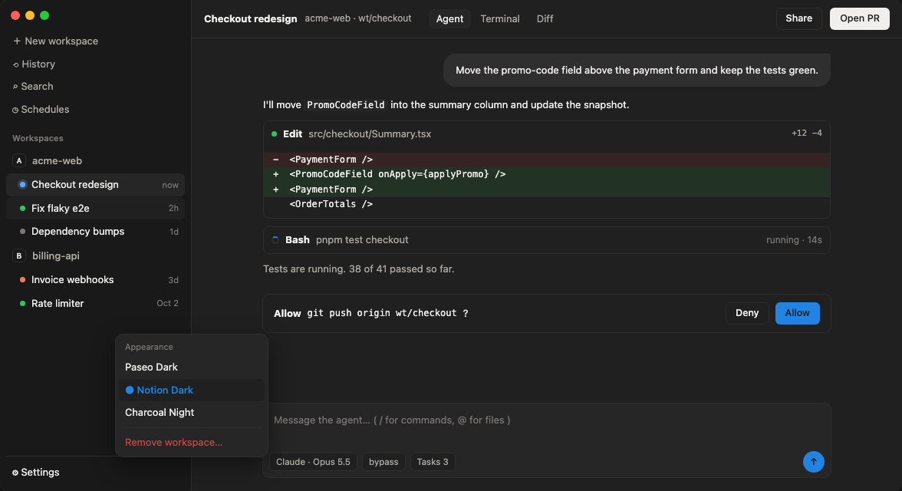

# Notion Dark for Paseo

A dark [Paseo](https://paseo.sh) theme using the colors of Notion's dark theme. Companion to [Notion Light](https://github.com/jnak/paseo-notion-light-theme).



## Install

```bash
paseo plugin add git:jnak/paseo-notion-dark-theme
```

Then pick **Notion Dark** under Settings → Appearance.

## Colors

| Paseo | Value | Notion token |
|---|---|---|
| background | `#191919` | `--c-bacPri` |
| foreground | `#f0efed` | `--c-texPri` |
| raised | `#202020` | `--c-bacSec` |
| control | `#262626` | `--c-bacInt` |
| border | `#2f2f2f` | `--c-palGra300` |
| accent | `#2383e2` | `--c-palUiBlu600` |
| mutedForeground | `#ada9a3` | `--c-texSec` |
| ring | `#7d7a75` | `--c-texTer` |

Unofficial; not affiliated with or endorsed by Notion.
